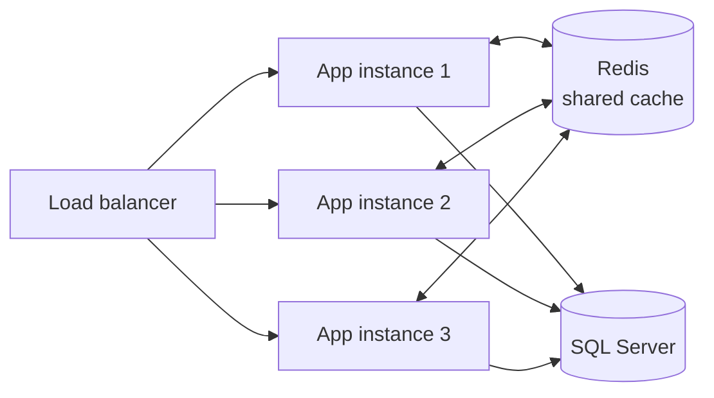
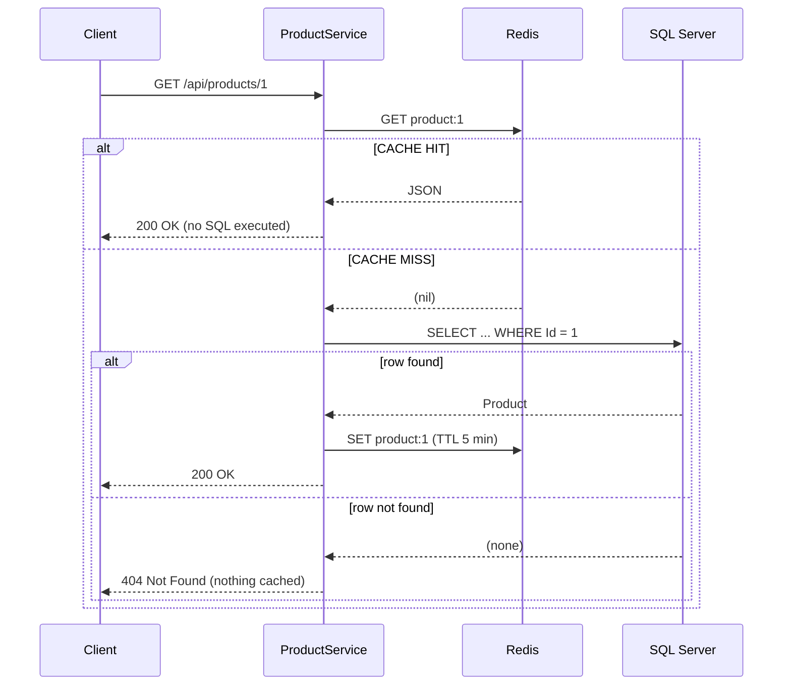
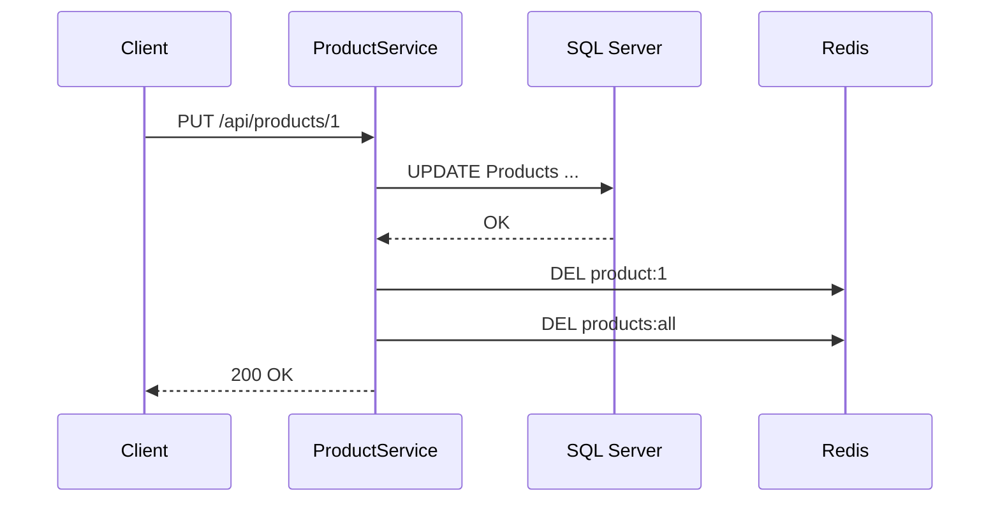
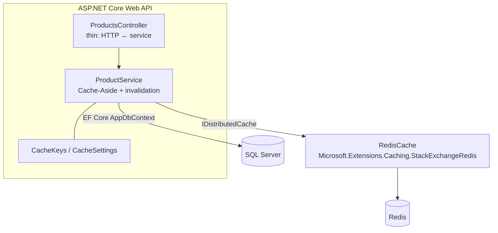
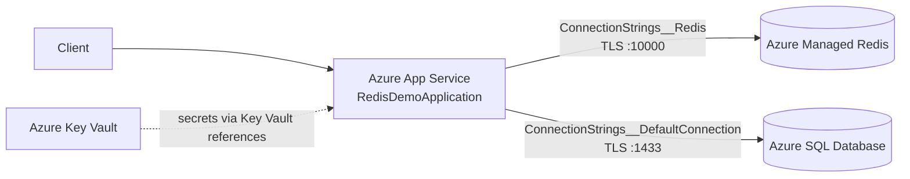

# Redis Demo – Product Catalog API

An educational ASP.NET Core (.NET 10) Web API that shows how **Redis** is used as a **distributed cache** in front of **SQL Server**, using the **Cache-Aside** pattern, **TTL expiration** and **cache invalidation**.

The application is built to run against local infrastructure today and against **Azure Managed Redis**, **Azure SQL Database** and **Azure App Service** later, with configuration changes only.

---

## Contents

1. [What is Redis?](#1-what-is-redis)
2. [Why is Redis useful?](#2-why-is-redis-useful)
3. [What is distributed caching?](#3-what-is-distributed-caching)
4. [The Cache-Aside pattern](#4-the-cache-aside-pattern)
5. [How this application integrates Redis](#5-how-this-application-integrates-redis)
6. [Cache expiration (TTL)](#6-cache-expiration-ttl)
7. [Why cache invalidation is necessary](#7-why-cache-invalidation-is-necessary)
8. [Running the application locally](#8-running-the-application-locally)
9. [Running Redis with Docker Compose](#9-running-redis-with-docker-compose)
10. [Configuring Azure Managed Redis and Azure SQL later](#10-configuring-azure-managed-redis-and-azure-sql-later)
11. [API reference with examples](#11-api-reference-with-examples)
12. [Demo script: CACHE MISS vs CACHE HIT](#12-demo-script-cache-miss-vs-cache-hit)
13. [Tests](#13-tests)
14. [Project structure](#14-project-structure)

---

## 1. What is Redis?

[Redis](https://redis.io/) is an open-source, **in-memory key–value data store**. Data lives in RAM, so reads and writes typically take well under a millisecond. Values can be simple strings (what this app uses — JSON-serialized products) or richer structures such as hashes, lists, sets, sorted sets and streams.

Redis is commonly used as a cache, session store, message broker (pub/sub, streams), rate limiter and leaderboard engine.

## 2. Why is Redis useful?

| Without a cache | With Redis |
|---|---|
| Every request runs a SQL query | Repeated reads are served from memory |
| Database CPU/IO grows with traffic | Database load drops to cache misses + writes |
| Latency = network + query execution + disk | Latency = network + in-memory lookup |
| Scaling reads means scaling the DB | Redis absorbs most read traffic |

Typical wins: lower response times, fewer database round-trips, lower database cost (smaller SKU / DTU), and better resilience to read spikes.

## 3. What is distributed caching?

An **in-memory cache** (`IMemoryCache`) lives inside one process. When an app runs on several instances (e.g. App Service scaled out to 3 instances) each instance has its own private cache — they don't share hits, and invalidating on one instance leaves stale data on the others.

A **distributed cache** is an external service that all instances share:



* A value cached by instance 1 is a cache hit for instance 2.
* Invalidating a key once removes it for every instance.
* The cache survives app restarts and deployments.

.NET exposes this through the **`IDistributedCache`** abstraction. This app codes against `IDistributedCache` and plugs Redis in with `AddStackExchangeRedisCache`, so business code is not coupled to Redis (tests use an in-memory implementation of the same interface).

## 4. The Cache-Aside pattern

In Cache-Aside (a.k.a. *lazy loading*) the **application** owns the cache logic; the cache and the database don't know about each other.

**Read path**



**Write path** — write to the database first, then *delete* the affected cache keys. The next read repopulates them with fresh data.



Why delete instead of overwrite? Deleting is simpler and safer: it avoids writing a value that might already be outdated, and the list key (`products:all`) would otherwise have to be rebuilt on every write.

## 5. How this application integrates Redis



| Piece | File | Role |
|---|---|---|
| Registration | `RedisDemoApplication/Program.cs` | `AddStackExchangeRedisCache` with the `Redis` connection string and an `InstanceName` key prefix; `AddDbContext` with `DefaultConnection` |
| Cache keys | `Caching/CacheKeys.cs` | `product:{id}` and `products:all` — the only place keys are named |
| Cache settings | `Caching/CacheSettings.cs` | Bound from the `CacheSettings` section (TTL, prefix) |
| Cache-Aside | `Services/ProductService.cs` → `GetOrLoadAsync<T>` | One generic helper used by both GET operations — no duplicated cache code |
| Invalidation | `Services/ProductService.cs` → `InvalidateAsync` | Called after successful POST / PUT / DELETE |
| HTTP | `Controllers/ProductsController.cs` | Maps results to 200/201/204/400/404 |

**Keys in Redis.** `InstanceName` (`RedisDemo:`) is prefixed automatically, so the real keys are `RedisDemo:product:1` and `RedisDemo:products:all`. `RedisCache` stores each entry as a Redis **hash** (fields `data`, `absexp`, `sldexp`) and sets a native Redis expiry on it.

**Serialization.** Values are serialized with `System.Text.Json` and stored via `GetStringAsync` / `SetStringAsync`.

**Logging.** Every cache decision is logged with the cache key or product id as a structured property:

| Log message | Meaning |
|---|---|
| `CACHE HIT - {CacheKey} served from Redis, database not queried` | Value returned from Redis |
| `CACHE MISS - {CacheKey} not found in Redis` | Must go to the database |
| `DATABASE QUERY - Loading product {ProductId} from SQL Server` | EF Core query about to run |
| `CACHE SET - {CacheKey} stored in Redis with TTL {TtlMinutes} min` | Value written to Redis |
| `DATABASE WRITE - Created/Updated/Deleted product {ProductId}` | Change saved |
| `CACHE INVALIDATION - {CacheKey} removed from Redis` | Key deleted after a write |

In Development, `Microsoft.EntityFrameworkCore.Database.Command` is logged at `Information`, so you also see the actual SQL (`Executed DbCommand ...`) — or its absence on a cache hit.

**Error handling.** Redis or SQL failures are **not swallowed**: they propagate, are logged by `UseExceptionHandler`, and the client gets a `500` RFC 7807 Problem Details response. The demo deliberately makes Redis outages visible. A production system might choose to degrade gracefully on *read* failures (log a warning and fall back to SQL), but must never ignore a failed *invalidation*, because that would leave stale data behind.

## 6. Cache expiration (TTL)

Each entry is written with an **absolute expiration relative to now** (`CacheSettings:ProductCacheExpirationMinutes`, default **5 minutes**). After 5 minutes Redis deletes the key by itself, and the next request is a cache miss that reloads fresh data.

TTL is a safety net, not the main consistency mechanism:

* It bounds how long stale data can survive if a change bypasses this API (e.g. someone edits the table directly in SQL).
* It keeps memory bounded — rarely-read products don't stay in Redis forever.
* Shorter TTL → fresher data, more DB load. Longer TTL → fewer DB hits, more risk of staleness.

You can watch the TTL count down in Redis:

```bash
docker exec -it redisdemo-redis redis-cli TTL "RedisDemo:product:1"
# (integer) 287
```

## 7. Why cache invalidation is necessary

Without invalidation, this happens:

1. `GET /api/products/1` → cached `{ "price": 89.99 }`
2. `PUT /api/products/1` with price `94.99` → database updated
3. `GET /api/products/1` → **cache hit, still returns 89.99** for up to 5 minutes ❌

So every successful write removes the keys it affects:

| Operation | Keys removed | Why |
|---|---|---|
| `POST /api/products` | `products:all` | The list is missing the new product. No `product:{id}` entry exists yet. |
| `PUT /api/products/{id}` | `product:{id}`, `products:all` | The item and the list both contain the old values. |
| `DELETE /api/products/{id}` | `product:{id}`, `products:all` | The item no longer exists; the list still contains it. |

Order matters: the database is written **first**, then the cache is invalidated. If the cache were cleared first, a concurrent read could reload the *old* row into the cache before the update commits.

> Note: Cache-Aside still has a small race window (a read that started before an update can write an old value back after the invalidation). The TTL bounds how long that can last. For this demo that trade-off is acceptable and is the standard behaviour of Cache-Aside.

## 8. Running the application locally

### Prerequisites

* [.NET 10 SDK](https://dotnet.microsoft.com/download)
* Docker Desktop (for Redis), **or** any reachable Redis instance
* SQL Server: **LocalDB** (installed with Visual Studio) **or** the optional SQL Server container from `docker-compose.yml`

### Steps

```bash
# 1. Start Redis
docker compose up -d

# 2. Restore the local EF Core CLI tool (pinned in dotnet-tools.json)
dotnet tool restore

# 3. Create / update the database (creates the Products table + 3 seed rows)
dotnet ef database update --project RedisDemoApplication

# 4. Run the API
dotnet run --project RedisDemoApplication --launch-profile http
```

* Swagger UI: <http://localhost:5069/swagger>
* OpenAPI document: <http://localhost:5069/openapi/v1.json>
* Ready-made requests: `RedisDemoApplication/RedisDemoApplication.http` (Visual Studio / VS Code REST Client / Rider)

### Configuration

`appsettings.json` (committed, no secrets):

```json
{
  "ConnectionStrings": {
    "DefaultConnection": "",
    "Redis": ""
  },
  "CacheSettings": {
    "InstanceName": "RedisDemo:",
    "ProductCacheExpirationMinutes": 5
  }
}
```

`appsettings.Development.json` points at LocalDB and local Redis (no credentials involved):

```json
{
  "ConnectionStrings": {
    "DefaultConnection": "Server=(localdb)\\MSSQLLocalDB;Database=RedisDemo;Trusted_Connection=True;TrustServerCertificate=True;MultipleActiveResultSets=true",
    "Redis": "localhost:6379,abortConnect=false"
  }
}
```

The app fails fast at startup if either connection string is missing.

To point Development at something else **without editing committed files**, use [user secrets](https://learn.microsoft.com/aspnet/core/security/app-secrets) or environment variables (`__` = section separator):

```bash
# user secrets (stored outside the repo)
dotnet user-secrets init --project RedisDemoApplication
dotnet user-secrets set "ConnectionStrings:DefaultConnection" "Server=localhost,1433;Database=RedisDemo;User Id=sa;Password=<your-password>;TrustServerCertificate=True" --project RedisDemoApplication

# or environment variables (PowerShell)
$env:ConnectionStrings__Redis = "my-redis-host:6379"
```

### Database migrations

The initial migration lives in `RedisDemoApplication/Migrations`. Common commands (run from the solution folder):

```bash
dotnet ef database update --project RedisDemoApplication                 # apply migrations
dotnet ef migrations add <Name> --project RedisDemoApplication           # after changing the model
dotnet ef migrations script --idempotent --project RedisDemoApplication  # SQL script, e.g. for Azure SQL
```

## 9. Running Redis with Docker Compose

`docker-compose.yml` at the solution root:

```bash
docker compose up -d                 # Redis 7.4 on localhost:6379
docker compose ps                    # health status
docker compose logs -f redis
docker compose down                  # stop (data volume kept)
docker compose down -v               # stop and delete data
```

Optional SQL Server 2022 container (if you don't have LocalDB). The SA password is **never committed** — it must come from your shell or an uncommitted `.env` file (ignored by `.gitignore`):

```bash
# .env  (not committed)
MSSQL_SA_PASSWORD=<a-strong-password>
```

```bash
docker compose --profile sql up -d
```

Then set `ConnectionStrings:DefaultConnection` to `Server=localhost,1433;Database=RedisDemo;User Id=sa;Password=<same-password>;TrustServerCertificate=True` via user secrets.

Inspecting Redis while you demo:

```bash
docker exec -it redisdemo-redis redis-cli
127.0.0.1:6379> KEYS RedisDemo:*
127.0.0.1:6379> HGET RedisDemo:product:1 data
127.0.0.1:6379> TTL RedisDemo:product:1
127.0.0.1:6379> MONITOR        # live stream of every command the API sends
```

## 10. Configuring Azure Managed Redis and Azure SQL later

No code changes are needed — only configuration. In Azure App Service, set these under **Settings → Environment variables** (connection strings or app settings), ideally as **Key Vault references** rather than plain values:

| Setting | Example value |
|---|---|
| `ConnectionStrings__DefaultConnection` | `Server=tcp:<server>.database.windows.net,1433;Database=<db>;Authentication=Active Directory Default;Encrypt=True;` |
| `ConnectionStrings__Redis` | `<name>.<region>.redis.azure.net:10000,password=<access-key>,ssl=True,abortConnect=False` |
| `ASPNETCORE_ENVIRONMENT` | `Production` |
| `CacheSettings__ProductCacheExpirationMinutes` | `5` (optional override) |



Notes:

* **Azure Managed Redis** listens on port **10000** with TLS required (`ssl=True`). Azure Cache for Redis (the older offering) uses `<name>.redis.cache.windows.net:6380`.
* **Azure SQL with Managed Identity**: `Authentication=Active Directory Default` lets the App Service's managed identity sign in — no SQL password at all. Grant the identity a database user (`CREATE USER [<app-name>] FROM EXTERNAL PROVIDER`).
* **Redis with Microsoft Entra ID** (no access keys) is possible too, but requires the `Microsoft.Azure.StackExchangeRedis` package and a small change to how the connection is configured — out of scope here.
* `EnableRetryOnFailure()` is already enabled on the SQL Server provider to handle transient Azure SQL errors.
* Apply migrations to Azure SQL from a pipeline using `dotnet ef migrations script --idempotent` or a migration bundle, rather than from the running app.
* Never commit these values. `appsettings.json` intentionally ships with empty connection strings.

## 11. API reference with examples

Base URL (local): `http://localhost:5069`

| Method | Route | Success | Errors |
|---|---|---|---|
| GET | `/api/products` | 200 list | — |
| GET | `/api/products/{id}` | 200 product | 404 |
| POST | `/api/products` | 201 + `Location` header | 400 |
| PUT | `/api/products/{id}` | 200 updated product | 400, 404 |
| DELETE | `/api/products/{id}` | 204 | 404 |

Validation: `name` required, max 200 chars; `description` max 2000 chars; `price` between 0 and 1,000,000.

**Get by id**

```http
GET /api/products/1
```
```json
{
  "id": 1,
  "name": "Mechanical Keyboard",
  "description": "Tenkeyless keyboard with brown switches.",
  "price": 89.99,
  "createdAt": "2026-01-01T00:00:00Z"
}
```

**Get all**

```http
GET /api/products
```
```json
[
  { "id": 1, "name": "Mechanical Keyboard", "description": "Tenkeyless keyboard with brown switches.", "price": 89.99, "createdAt": "2026-01-01T00:00:00Z" },
  { "id": 2, "name": "Wireless Mouse", "description": "Ergonomic mouse with USB-C charging.", "price": 39.50, "createdAt": "2026-01-01T00:00:00Z" },
  { "id": 3, "name": "27\" Monitor", "description": "1440p IPS monitor, 144 Hz.", "price": 299.00, "createdAt": "2026-01-01T00:00:00Z" }
]
```

**Create**

```http
POST /api/products
Content-Type: application/json

{ "name": "USB-C Hub", "description": "7-in-1 hub with HDMI and card reader.", "price": 49.90 }
```
```http
HTTP/1.1 201 Created
Location: http://localhost:5069/api/Products/4
```
```json
{ "id": 4, "name": "USB-C Hub", "description": "7-in-1 hub with HDMI and card reader.", "price": 49.90, "createdAt": "2026-11-05T13:40:12.512Z" }
```

**Update**

```http
PUT /api/products/1
Content-Type: application/json

{ "name": "Mechanical Keyboard (v2)", "description": "Tenkeyless keyboard with red switches.", "price": 94.99 }
```
→ `200 OK` with the updated product.

**Delete**

```http
DELETE /api/products/4
```
→ `204 No Content`

**Validation error**

```http
POST /api/products
Content-Type: application/json

{ "name": "", "price": -1 }
```
```json
{
  "type": "https://tools.ietf.org/html/rfc9110#section-15.5.1",
  "title": "One or more validation errors occurred.",
  "status": 400,
  "errors": {
    "Name": [ "The Name field is required." ],
    "Price": [ "The field Price must be between 0 and 1000000." ]
  }
}
```

**Not found** → `404` with a Problem Details body.

## 12. Demo script: CACHE MISS vs CACHE HIT

With Redis running and the API started, open `RedisDemoApplication.http` (or use curl) and watch the API console.

**1. First read — cache miss**

```bash
curl http://localhost:5069/api/products/1
```
```
info: RedisDemoApplication.Services.ProductService[0]
      CACHE MISS - product:1 not found in Redis
info: RedisDemoApplication.Services.ProductService[0]
      DATABASE QUERY - Loading product 1 from SQL Server
info: Microsoft.EntityFrameworkCore.Database.Command[20101]
      Executed DbCommand (3ms) [...] SELECT TOP(1) [p].[Id], ... FROM [Products] AS [p] WHERE [p].[Id] = @id
info: RedisDemoApplication.Services.ProductService[0]
      CACHE SET - product:1 stored in Redis with TTL 5 min
```

**2. Same request again — cache hit, no SQL**

```bash
curl http://localhost:5069/api/products/1
```
```
info: RedisDemoApplication.Services.ProductService[0]
      CACHE HIT - product:1 served from Redis, database not queried
```

No `DATABASE QUERY` and no `Executed DbCommand` line: SQL Server was not touched.

**3. Update — invalidation**

```bash
curl -X PUT http://localhost:5069/api/products/1 -H "Content-Type: application/json" \
     -d '{"name":"Mechanical Keyboard (v2)","description":"Red switches","price":94.99}'
```
```
DATABASE WRITE - Updated product 1
CACHE INVALIDATION - product:1 removed from Redis
CACHE INVALIDATION - products:all removed from Redis
```

**4. Read again — miss, fresh data reloaded**, then hits again until the next write or until the 5-minute TTL expires.

Tip: run `docker exec -it redisdemo-redis redis-cli MONITOR` in another terminal to see the `HMGET`, `HSET`/`EXPIRE` and `DEL` commands arrive in real time.

## 13. Tests

```bash
dotnet test
```

`RedisDemoApplication.Tests` (xUnit v3) runs the **real** `ProductService` and `ProductsController` against:

* **SQLite in-memory** as a stand-in for SQL Server (via the production `AppDbContext`, including seed data), with an EF Core `DbCommandInterceptor` that **counts SQL commands** — this is how tests prove the database was or wasn't queried.
* **`MemoryDistributedCache`** — the framework's in-memory `IDistributedCache` — as a stand-in for Redis.

No production code was changed for testability.

Covered behaviour:

* Product is read from the database when the cache is empty
* Product is cached after a database lookup
* Product is returned from the cache when present (cache holds a deliberately different value to prove the source)
* Database is not queried on a cache hit / on a second identical request
* Product list caching (`products:all`)
* POST invalidates `products:all`; subsequent list includes the new product
* PUT invalidates `product:{id}` and `products:all`; re-read returns new values
* DELETE invalidates `product:{id}` and `products:all`
* Missing products: `null`/`false` from the service, `404` from the controller, nothing cached
* Controller status codes (200, 201 + `CreatedAtAction`, 204, 404)

## 14. Project structure

```
RedisDemoApplication/                     solution root
├── docker-compose.yml                    Redis (+ optional SQL Server profile)
├── dotnet-tools.json                     pinned dotnet-ef tool
├── RedisDemoApplication.slnx
├── RedisDemoApplication/                 Web API
│   ├── Caching/
│   │   ├── CacheKeys.cs                  product:{id}, products:all
│   │   └── CacheSettings.cs              TTL + key prefix (config-bound)
│   ├── Contracts/ProductRequest.cs       validated request body
│   ├── Controllers/ProductsController.cs
│   ├── Data/AppDbContext.cs              EF Core model + seed data
│   ├── Entities/Product.cs
│   ├── Migrations/                       InitialCreate
│   ├── Services/ProductService.cs        Cache-Aside + invalidation + logging
│   ├── Program.cs                        DI: EF Core, Redis, OpenAPI/Swagger UI
│   ├── appsettings.json                  no secrets
│   ├── appsettings.Development.json      LocalDB + localhost Redis
│   └── RedisDemoApplication.http         demo requests
└── RedisDemoApplication.Tests/           xUnit v3 tests
```
